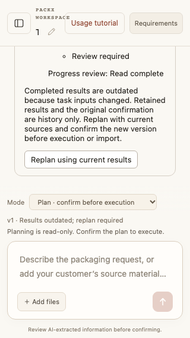

# 2026-10-19：完成只读结果的来源过期闭环

基线：重新 fetch 与 ls-remote 核验的 main `42ff79c8a8e680ab436c170ca2d6f1aaab4e7b1d`（PR #55）；没有本地落后或未合并修复。工作区 `/Users/black/Documents/Codex/2026-10-19/task/packx-readonly-result-validity`，本地分支 `codex/readonly-result-validity`。原目录 179 个未提交文件受独立内容/权限/状态清单保护。本阶段不提交、推送、创建 PR、合并、部署或调用付费模型。

## 基于代码的选择

运行中失效及收据恢复已随 PR #55 合入，不重复实现。本轮找到的可复现缺口是完成计划的当前有效性：只读图完成后，`read` 不核对输入、`dispatch` 只核对活动计划，撤回选定报告仍显示完成并保留需求单导入按钮。基线新增回归实际失败：期望 stale，收到 completed。现有导入检查可拦住变化的报告，所以本轮补齐持久状态与用户恢复路径，不声称此前能绕过业务审批。

本轮新增状态及边界见 [ADR-0040](../adr/0040-completed-readonly-result-validity.md)。节点独立租约、跨图并发、公平性、任意业务依赖、并发写入和代码执行继续延期。完成后的 Fact 校验仅覆盖冻结时已确认的输入，新增下游候选/确认和阶段状态不是旧 Plan 的上游依赖；普通候选 Fact 的通用依赖和任务快照外任意历史本地文件监控不在本轮范围；未知来源存储故障报错，不伪造过期。

## 可验收行为

- 完成后的冻结任务输入变化，追加一次 `plan.results_stale`，保留原节点结果、尝试、确认、代次、执行槽及连续失败数；不请求 Runtime 或模型。
- 读取、报告变更通知和需求单导入共用校验入口。丢失通知后重开存储首次读取修复；重复读取、重启、恢复输入或重选报告不复活旧状态。
- UI 轮询从完成切换为过期，保留历史节点与引用，只提供显式重新规划。旧导入、确认、恢复和零调用对账请求被拒绝。
- 用户明确重新规划只生成新待确认版本；再次确认才执行新的只读节点，旧版本结果保留。

## 实际验证

本机 Node 24.14.0，正式入口使用仓库过滤后的环境，不读取真实模型凭证。以下均为本地实际结果；不是本轮远端 CI 或真实模型验收。

| 检查 | 实际结果 |
| --- | --- |
| 完整 core、类型与构建 | 1,298 通过、0 失败、50 个既有平台条件跳过，共 1,348 项；类型与构建通过 |
| 12 项离线 Eval | offline、context、recovery、loop-safety、memory、m1、m2、plan、plan-graph、plan-parallel、source-report、packaging-lifecycle 全通过；同固定模型/图/预算的串行并行对照保持输出与调用量一致 |
| 完整浏览器 | 57/57 通过，0 失败/跳过/flaky；桌面中文、390px 中文、320px 英文覆盖完成→过期轮询、历史节点、移除入口和点击重新规划后等待新确认 |
| 正式 native | 48/48 原生安全回归通过，0 跳过；完整真实 Host HTTP 流程通过，包括旧幂等导入、Fact 确认、审批/导出及新增持久过期/重启/重新确认 |
| 故障回归 | 基线先复现失败；新增恢复输入不复活、重启首次读取修复、重复读取不重复事件、存储故障保留状态、作用域隔离、旧串行兼容、严格状态校验，以及七类输入变化/下游草稿和确认不反向失效 |
| 安全、差异与保护 | 工作流/路径策略通过；凭证扫描负对照通过，跟踪树、完整 Git 历史及包含全部新文件的候选树均无发现；依赖审计所有严重度均 0；差异检查及文档链接检查通过；原目录 179 个文件内容/权限/状态一致 |

core 的 50 项条件跳过仍为 38 项 macOS 原生条件项和 12 项 Windows 条件项。macOS 正式 native 入口另执行全部 48 项；本轮没有 Windows runner。浏览器截图为固定 API 数据，真实执行与持久化证据来自上面的 Host HTTP 流程。



## 应用级验收和演示

Node 24.14.0，使用本机固定 Provider，真实 Host、HTTP、本地认证、队列、Runtime、来源和持久状态，不连接模型厂商：

```sh
node --import tsx scripts/ci.ts core
node --import tsx scripts/ci.ts browser
node --import tsx scripts/ci.ts native
npm run dev:fixture
```

自动流程先完成 `parallel-fixture-success` 的两个独立读取和依赖汇总，再清除报告选择。断言只有 Plan revision 增加一次，历史结果/确认/计数不变，旧导入和执行命令被拒绝且固定 Provider 计数不变。真实 Host 退出/重启后读取仍过期；重选 v1 也不能复活。显式 replan 生成 v2 后只发生规划调用，没有子任务输出和确认；确认 v2 后才执行并完成新图。

交互演示：上传 `examples/source-report-customer.txt`，创建并明确选择资料报告，进入“先规划”并输入 `parallel-fixture-success`；确认图后等待完成。清除报告选择，应在 Plan 面板看到过期提示、保留的历史节点及重新规划入口，不再显示“将结果转为需求单草稿”。重新选择报告仍显示过期；重新规划、核对并确认新版本后才能继续。此演示是固定响应，不代表真实模型推理或用户价值。

## 失败历史与原始记录

基线回归失败保留于本机 `/private/tmp/packx-result-validity/baseline-failure.log`。首次类型构建发现可选 Plan 在 version 为 undefined 时不能安全缩窄；修正为显式存在性检查，未放宽类型规则。首次正式 native 的 48 项原生回归通过，但真实应用的幂等导入被整段上下文比较误判为来源变化；改为来源投影后又发现新导入的已确认 industry Fact 仍被误当旧输入。最终固定原计划已确认 Fact/原有 Artifact 的依赖集合，增加七类来源变化与下游草稿/确认不反向失效的回归，并保留原幂等导入、字段确认、审批和导出全流程，不修改断言来接受回归。后续日志记录在同目录 `targeted*.log`、`build*.log`、`core-final.log`、`browser-final.log`、`native-final.log` 及安全检查日志；首次原生应用失败保留在 `native.log`、`product-basis.log`，定向来源依赖检查在 `source-basis*.log`。只把汇总和固定 fixture 纳入仓库，不加入用户数据、运行凭证或整份本机日志。

## 交付边界

本轮没有实际远端 CI、Windows runner 或员工真机验证；没有公网正向读取、付费模型质量/费用或真实用户收益证据。PR #55 本身及其合并 main 的既有 CI 通过，是基线证据，不替代本轮检查。未新增依赖、凭证、系统安全设置或 CI 例外。

## 本地变更清单

仅以下 20 个文件，均未暂存或提交；实现/Schema/UI 与测试/真实应用评测同步，文档包含 ADR、演示、边界及一张固定数据截图。

```text
README.md
README.zh-CN.md
docs/README.md
docs/adr/0040-completed-readonly-result-validity.md
docs/evidence/readonly-result-validity-2026-10-19.md
docs/evidence/readonly-result-validity-2026-10-19/narrow-results-stale-en.png
docs/plan-mode.md
docs/workspace-agent-architecture.md
docs/workspace-agent-delivery.md
eval/productSmoke.ts
server/enterprise/agentPlanWorkflow.ts
server/enterprise/parallelPlanWorkflow.test.ts
server/index.ts
server/manufacturing/planRequirementSource.test.ts
server/manufacturing/planRequirementSource.ts
src/components/PlanPanel.tsx
src/enterprise/agentPlan.test.ts
src/enterprise/agentPlan.ts
src/i18n.ts
tests/browser/planParallel.spec.ts
```
