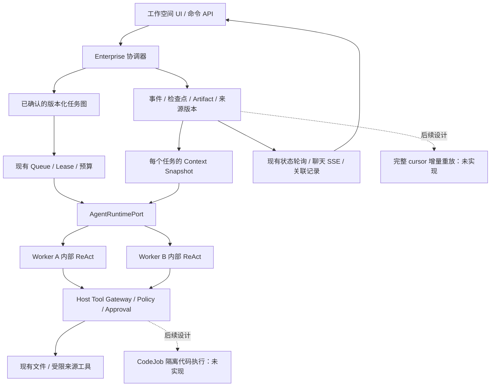

# Packx 工作空间 Agent：架构与分阶段交付

日期：2026-10-18。工程基线：`1326092260672164e52fbae685aa271f2ca4870a`；最终本地分支同时保留已修复的模板库 PR #40（`b1c92d7`）。
状态：四节点 DAG、来源报告与显式版本到 worker 的只读闭环已实现。最多两个只读节点并行已随 PR #54 合入 main `8663797`；含写入/旧计划保持串行，未部署。见 [ADR-0037](adr/0037-bounded-readonly-plan-waves.md) 和[原阶段验收](evidence/readonly-parallel-2026-10-19.md)。2026-10-19 后续本地阶段补充来源变更主动失效，见 [ADR-0038](adr/0038-readonly-source-invalidation.md) 与[当前验收](evidence/readonly-source-invalidation-2026-10-19.md)；后续补齐来源持续复核、报告业务依赖与零调用对账，见 [ADR-0039](adr/0039-readonly-source-recovery-and-report-dependencies.md) 和[当前补齐验收](evidence/readonly-recovery-completion-2026-10-19.md)。仅授权通过测试后本地提交，未推送、创建 PR 或部署。
2026-10-19：本批获发布与条件合并授权，已合入 main `243b691`；发布前检查和未验证边界见[发布验收](evidence/workspace-agent-publication-2026-10-19.md)。

决策：[ADR-0034](adr/0034-workspace-agent-task-graph.md)。验收：[本轮证据](evidence/workspace-agent-upgrade-2026-10-18.md)。

## 1. 从现状出发

Packx 已有长任务基础，升级应复用它们。React 是界面框架；ReAct 是模型与工具交替执行的循环。两者都不必为 Multi-Agent 更换。ReAct 可以继续存在于每个 worker 内部；跨任务的调度、恢复和权限由 Host 负责。增加 Agent 数量不会自动解决崩溃、重复副作用、上下文失效或任务无限循环。

| 当前代码 | 已有行为 | 本轮处理 |
| --- | --- | --- |
| `src/agent/loop.ts`、`server/runtime/agentRuntime.ts`、`src/runtime/contracts.ts` | 模型/工具循环、Session、压缩、权限与失败、Runtime Port | 保留；不新增第二套循环 |
| `server/enterprise/agentPlanWorkflow.ts`、`agentPlanStore.ts` | 确认具体版本、最多 4 节点 DAG、SQLite 事件、跨版本预算 | 新只读图最多两项并行，含写入/旧图串行 |
| `server/workers/stageJobScheduler.ts`、`src/enterprise/stageJobQueue.ts` | 确定性 job、lease/heartbeat、取消、失败/恢复、失效 worker 防护 | 复用同一计划 job，不加总线或队列 |
| `server/runtime/recoverCompletedTurn.ts` | 按 Session 与完成 Trace 取回结果；证据缺失时停止 | 任务身份仍绑定版本/索引，复用恢复路径 |
| `server/enterprise/taskContext.ts`、`taskCheckpointStore.ts` | 来源与版本化上下文、任务检查点 | 保留共享来源快照；新增显式上游报告 |
| `server/runtime/conversationFiles.ts`、`localFileAccess.ts` | 文件授权、版本检查、执行账本和对账 | 保留；计划确认不等于文件批准 |
| `server/runtime/macOsSeatbeltSandboxedToolExecutor.ts`、`assetInspection.ts` | macOS 原生文档工具隔离；Windows 文本能力单独受限 | 不把它们冒称任意代码 sandbox |
| `server/manufacturing/requirementBriefApi.ts`、`src/components/*` | 需求单 Fact/Artifact/Approval 与交付 UI | 继续工作；计划结果仍是未验证报告 |
| `server/runtime/researchTools.ts`、`egressProxy.ts` | 固定研究 fixture 工具、受限出口基础 | 不是通用网页浏览产品 |
| `.github/workflows/pr-checks.yml`、`scripts/ci.ts` | core、browser、native、Windows 与汇总门槛 | 原门槛保留；增加图评测与必需套件 |

现有产品仍面向包装售前/跟单。新方向是“工作空间 + 任务 + 交付物”，需求单作为保留的一个工作流，而不是把全部能力绑在需求单表单上。本轮没有开放通用行业入口，也没有执行真实模型或迁移用户业务数据库。

## 2. 产品闭环与边界

首个扩展场景：用户在一个工作空间中选取附件/已授权文件和网页资料，要求“对照供应商说明，产生带来源的比较报告和待确认事项”。简单任务一个 worker 完成；确有独立来源核验或独立交付物时拆分；最后一个节点消费明确依赖的报告。已完成的最新 Plan 可显式导入未验证需求单草稿；报告绑定须再次核对并作为受保护依赖保留，来源变化让业务 Artifact/Approval 失效。报告选择、计划确认、业务 Fact 确认和审批各自独立；报告不能改写已确认 Fact。

目标工作空间含：任务列表、当前计划与进度、资料/文件、版本化交付物、待确认操作、历史与运行诊断。一个工作空间可有多个任务；Conversation 是交互视图，不再承担全部业务状态。工作目录是用户授权路径；来源和交付物注册表是逻辑资源索引，两者不等价。未来允许新建通用任务时用显式 Domain 配置承载，不删包装规则，不在 Core 中塞行业判断。

当前已在串行 DAG 外贯通独立的[资料报告切片](source-reports.md)：文本附件/受限网页到不可变来源快照和报告 Artifact。已进一步接入[明确选择报告版本到 DAG worker 的只读闭环](workspace-agent-delivery.md)。另已接入报告→需求单→审批/导出的有限依赖链。代码、通用 Agent 网页工具、任意业务对象的通用依赖图及 UI 增量事件投影仍为后续阶段。

## 3. 协调器与任务图

协调器是确定性程序，不是具有无限权限的“老板 Agent”。模型可以提出任务、依赖和角色；Host 校验图、来源版本、工具集合、预算、审批与执行证据，决定是否派发。

当前合同：`PlanSpec.tasks[]` 中可选 `dependsOn: number[]`，指向同版本内零起始索引。省略/空数组表示独立。拒绝越界、自依赖、重复、非整数和环。索引在这个不可变版本中稳定。旧图及含写操作图每次选取索引最小的就绪节点；新只读图每片选取至多两个就绪节点，使用独立 Session 和尝试身份，下一批等待本批结束。收据可按完成顺序追加，展示顺序和依赖路由保持用户确认的索引。

沿用 Plan 状态机和 `children` 完成收据。串行图保留 `activeTask`；新只读图使用持久 `taskRuns`，记录尝试身份、父 lease、状态与失败，转换保留在 SQLite 事件。就绪/等待由图和收据计算。更大图或节点独立队列仍需另建合同，不能将本次投影等同于完整的 `blocked → ready → leased → running → succeeded | failed | cancelled | awaiting_approval | reconciliation_required` 状态机。

动态分工以有界重规划实现：worker 遇到缺失资料/假设冲突，提交 `assessment=replan`，Host 停止后续节点；规划器读取旧结果引用与当前来源，提出新版本；用户确认新版本后执行。当前最多 4 个版本/32 片，不存在模型随意 spawn 的工具。未来新增角色只是一组指令、工具能力和输出合同；不能自动变成独立 Agent。

计划边、工具或预算变化必须形成新版本。新增外部副作用/权限时重新确认和单独批准。纯运行时把同一已批准节点分配给空闲 worker 可由 Host 自主进行；不因此改变任务语义。不能为了“自主”跳过审批。暂不做递归委派、自动增删节点或自动循环重规划。

### 已实现的状态生命周期

- Plan：planning → awaiting_confirmation → queued → running → completed。运行可进入 paused / failed / cancelled；恢复只将已确认、来源未变且可重试的 paused/failed 版本排队。旧版本被修订时进入 superseded。worker 报告 replan 或缺完成证据会停止，不能自行恢复为成功；新版本需要重新确认，预算跨版本累计。
- 只读节点：running → completed / paused / failed / interrupted。失败停止同批及下游；已提交节点保留。新尝试扣除执行槽并保留旧尝试事件；Runtime 主动暂停继续原 Session/key，其他中断工作在复核完成记录后采用新尝试身份。
- SourceReport：queued → running → completed；任一未完成步骤可取消，失败进入 failed。仅可重试错误支持显式 retry，递增 generation/attempt，保留已提交来源收据；最多三次尝试。新报告是新版本，不覆盖 completed 内容。
- 选择状态独立于报告运行：未选择 → selected(vN, digest, selectionRevision) → cleared；每次选择/清除均追加修订号，即使重选同版也使旧绑定失效。Report completed 不代表被选定，Plan completed 不代表 Fact 验证或文件批准。
- 取消/暂停通过持久状态、AbortSignal 与 lease fence 阻止后续派发/提交；不承诺撤回已经发送的模型输入或回滚外部副作用。页面关闭不等于任务取消。

## 4. Agent 与 Tool 协议

复用 `RuntimeTurnRequest/Result`，不新造远程 agent bus。请求有 tenant/workspace/run、stage、actor、session、idempotency key、input、taskContext binding、工具白名单、输出 Schema、超时与执行限额。完成结果有 execution/session、状态、事件、Usage、结构化 summary/evidence/limitations/assessment。完成文本只是候选证据，不能自行转换业务状态。

第一批上游报告信封：`{planVersion, taskIndex, sessionId, executionId, status:"unverified", result}`。只取直接依赖，来自当前 scope 的已持久化结果；需有非空 evidence 和 `assessment=continue`。来源引用仍需业务 Evaluator 核对，非空不等于真实。报告输入为不可信数据，不能替代系统指令或授权。依赖总 JSON 超过 24,000 字符时在预留下一模型调用前停止，不静默截断。

Tool 继续沿用 Core 的输入 Schema/validate、风险、幂等、timeout、maxResultChars、执行位置及独立账本。后续 Gateway 应补足统一输出 Schema、可重试分类、资源访问声明（读/写集合、网络目的地）、结果引用和 Tool receipt。不要把工具名或“支持 MCP”误认为安全审计完成。

如未来需要 MCP，适配在 Tool Gateway 外缘，冻结支持的协议版本与工具清单，不让第三方 MCP 获得业务数据库或 Host 凭证。MCP 传输授权与 Packx 业务批准是不同检查；参考 [MCP 授权规范](https://modelcontextprotocol.io/specification/2025-11-25/basic/authorization)。暂不需要 A2A、服务发现或远程 Agent 互信体系。

## 5. 上下文隔离与共享信息

分为四层：

1. 不可由模型改变的策略、权限和预算；由 Host 编译，优先级最高。
2. 有来源、状态和版本的共享资料索引/Fact/Artifact；由 ContextEngine 按需读取。
3. 当前任务的目标、冻结来源、直接上游报告引用、失败与恢复检查点。
4. worker 自己的消息、工具结果与工作记忆；只属于该 Session。

第一批所有 worker 仍共享已确认的父来源快照；隔离的是 Session 与未声明的兄弟报告，不是资料逐字段保密或独立文件系统。依赖报告通过 input 进入 worker；其完整内容参与 taskContext binding，因此暂停后上游数据改变不能继续旧检查点。独立任务保持原 binding，旧数据可读取。没有兄弟推理消息或“共享全局聊天历史”。

后续为每个节点冻结 sourceRef+version+sha、Artifact version、选定 Fact versions 和权限摘要；输出只发布到版本化 Artifact，再由下游按引用读取。大文件留在来源/Artifact store，模型只得到索引与受限节选；读取有 provenance 与截断标记。压缩只处理工作记忆，不重写权威 Fact、审批和策略。权限撤回、来源删除/变更、上游 Artifact stale 时停止相关节点，派生结果标记 stale，重新评测或确认。

## 6. 持久化、检查点、恢复与对账

复用 SQLite `plan_events` 的事务 CAS、命令去重、scope 索引；Queue 仍是现有持久实现。计划状态是投递意图，确定性 jobId 修复“确认已提交、入队前崩溃”的窗口。Node SQLite 是同步接口，[固定 Node 24.14 文档](https://nodejs.org/download/release/v24.14.0/docs/api/sqlite.html)；当前 4 节点单机规模继续适用，不提前迁 PostgreSQL。

| 故障窗口 | 恢复依据与动作 |
| --- | --- |
| 确认提交、尚未入队 | reconcile 从已确认版本补投同一 jobId |
| 已预留调用、尚未收到响应 | 保留调用消耗；不能因 crash 获得额外预算；查询 Runtime/Provider 可用证据 |
| Session 完成、Plan 结果未提交 | 复用完成 Trace + Session；没有完成 Trace 时 `plan_completion_evidence_missing` 停止 |
| 已提交 child、Queue ACK 前崩溃 | 根据 taskIndex 完成收据跳过；不能用 children.length 推断任务身份 |
| 只读批次执行中 Host 被强杀 | 先用现有 recover-lock 核对旧 PID 并记录审计；lease 过期后显式恢复，按节点完成 Trace 对账，已提交结果不重跑，不明消耗不退还 |
| lease 过期/取消后迟到结果 | 提交前验证 lease、generation、source binding；拒绝迟到提交 |
| Tool 已发生副作用、receipt 丢失 | 账本 started/unknown → Host 查询目标状态/文件哈希，证实后 reconcile；不重放猜测 |
| 存储不可用/结果不完整 | 不把未知当失败，也不把模型“完成”当成功；保留证据并停止 |

每个 Tool 的幂等键须绑定 scope、逻辑操作、目标资源和输入摘要；重试复用相同逻辑 key，同 key 换 payload 拒绝。按执行 attempt 生成新 key 会掩盖重复写入，禁止。模型调用也可能已计费但没有响应，不承诺 exactly-once。恢复过程中任何读回都重新检查权限和来源。

当前只读节点投影携带版本/attempt、父 lease、Session/key 与代次，输入 binding 和完成 Tool/Usage 证据仍由原 Runtime/Trace 保存。跨系统 Checkpoint 的统一信封、预算修订引用及节点独立 lease 为后续。暂停只暂停派发和可中断执行，不假设外部世界回滚。代码执行器、外部服务必须有具体取消/清理证明。MCP 的取消是协议通知，不能替代操作结果核验，见[取消规范](https://modelcontextprotocol.io/specification/2025-11-25/basic/utilities/cancellation)。

## 7. 并发与文件冲突

本地后续阶段仅将全部工具属于 Host 只读白名单的新图标为 readConcurrency=2，并在确认前展示。一个 Queue job 的排他 lease 覆盖整图、最多两个运行节点；没有跨图并发。每个节点在调用前用 SQLite CAS 保存尝试/父 lease 并消耗共享执行槽，结果提交复核 lease、代次、尝试、来源与版本。不同 Session、直接依赖报告、read-only/never 权限保留。批次等待慢节点，当前只沿用原队列的批次间调度，不声称跨租户公平或多主机隔离。

取消/单项失败中断同批，成功收据保留；超时与迟到结果有提交 fence。失去图租约后保留 maxFailures=1，等待用户恢复及完成记录对账，未知费用不自动重试或退还执行槽。固定同图/同预算对照验证调用量与输出一致、两个请求确实重叠；人工等待的耗时不能证明真实模型收益。节点独立 lease、跨图资源 reservation、公平调度和并发写入均延期，见 ADR-0037。

报告变更 API 成功持久化选择/清除后，立即对当前 scope 派发入口复核；已确认只读图的输入修订或上下文改变时，先保存 `plan.sources_changed` 失败事件，再走原整图取消路径中断运行尝试及重复 job。不会等待挂起 Provider 返回，成功收据保留为待核对历史，旧确认不能直接恢复。启动/后续 reconcile 修复报告保存、计划失效与队列取消之间的崩溃窗口；上下文存储不可用不等于来源已撤回。此主动通知仅覆盖报告变更 API，其他来源/权限变更继续受 Runtime/提交前复核和下次对账保护；没有通用运行时来源 watcher 或跨业务 Artifact stale 图。

后续设计（未实现）：并发写任务采用每节点私有 staging 目录 `workspace/.packx-runs/run/node/attempt/`，只允许生成候选输出，不直接覆盖用户原件。Host commit 阶段验证 expected original hash/Artifact version、权限、审批绑定版本，然后原子提交新版本。目标资源规范化后登记写集合；同路径/祖先目录冲突串行化。CAS 冲突标记 `conflict`，保留两个版本供人工选择，不让模型最后写入获胜。

代码项目用独立 checkout/worktree、明确 patch/base commit 和受限合并器；二进制、批准交付物和非 Git 目录不自动合并。路径穿越、符号链接、硬链接、case-insensitive 文件名、改名与权限撤回进入攻击集。只做进程锁或路径字符串前缀比较不够。

## 8. 文件、网页、代码三种能力的安全边界

| 能力 | 最小产品形态 | 权限和 sandbox | 开放门槛 |
| --- | --- | --- | --- |
| 文件（已有基础） | 授权目录/附件索引、原文引用、候选交付物 | 继承父 scope，工具/路径只能收紧；写入另批；保护 Host data/Secret | 文件版本冲突、撤权、路径攻击、恢复测试 |
| 网页资料（报告链路已实现） | 受限 fetch → 带 URL/时间/hash 的来源 Artifact；浏览器交互再后置 | Host egress allowlist，限制 scheme/端口/重定向/DNS、响应大小和时限；无 cookie/凭证继承 | SSRF、DNS rebinding、私网/元数据地址、重定向越界、恶意 Prompt 测试 |
| 代码执行（后续，默认关闭） | 一次短时、无网络、有限输入的 CodeJob，输出文件清单和 stdout 摘要 | 可信 Host 编译 manifest；独立进程/容器边界；CPU/内存/PID/磁盘/时间/输出限额；只读输入与私有输出；不挂载 Home/Host 状态/凭证 | 真机攻击集、杀进程树、超额/逃逸/符号链接/输出审计、崩溃回收；平台不支持即拒绝 |

不能用 Node `vm`、Prompt “不要访问”或 `sandboxMode` 字符串充当任意代码隔离。当前 macOS 文档执行器与 Windows 文本工具只证明其窄能力；云端、多租户和任意代码需新的运行边界验收。OS 选择、网络扩权、长期凭证和费用是安全决策点，不在本轮自行启用。

子权限 = 用户授权 ∩ 工作空间策略 ∩ 已确认节点工具/路径范围 ∩ 当前 lease 能力。模型建议和上游输出不参加授权计算。权限撤回对每次工具调用和结果提交生效；每个外部调用复核 actor。当前本机 owner 模式不能冒充完整企业 RBAC。

## 9. 取消、重试、预算与人工确认

- 取消持久化 generation/status 后中止当前 job；迟到结果不能提交。保留已有报告和未知 Tool 账本，不删除用户数据。暂停后必须显式恢复。
- Provider 临时故障允许有界恢复；来源变更、无效合同、权限、评测、未知副作用和 replan 门槛不能普通自动重试。基础设施重试使用退避/抖动与最大次数；预算随重启保留。
- 当前每版 16 片、跨版本 32 片、4 版本、连续失败 3 次；每片 4 迭代/8 Tool/12k 输入/60 秒。这些是上限，不是精确美元账单限额。
- 后续 Model Gateway 增加持久预算 reservation：派发前按输入/输出上限预留 token 和费用；成功结算，计费未知保守占用；跨 Agent 共享总额，不允许子 Agent 分别“各有一份总预算”。Provider 支持的输出上限和重试次数也要计入。费用上限无法核实时拒绝高成本路由，不能用最后 Usage 事后补救。
- UI 确认绑定最新 graphVersion、source digest 和 revision；自然语言“同意”不替代确认命令。重规划要重新确认，文件写/删除、发布、发客户、生产提交仍各自绑定资源与版本单独批准。用户明确拒绝必须终止相关动作。
- 接受 worker 的报告不等于审批最终交付物。完成条件应由 Schema + 来源 + 必需确定性 Evaluator + Approval Gate 共同判定；模型自评只是一个停止信号。

## 10. 流式 UI 与观测

现有计划面板增加“使用哪些任务结果”的中英文提示，确认前即可检查。当前状态仍经原有读取/刷新路径展示；本轮没有增加通用任务工作台或可重放的 DAG SSE 协议。

下一阶段的事件信封建议：eventId、scope、runId、graphVersion、nodeId、attempt、executionId、correlationId、sequence、timestamp、type、payloadRef。UI 先拿持久投影快照 + cursor，再订阅增量；断线按 cursor 补读，重复事件去重、乱序缓冲，无法补齐就重新取快照。模型 delta 是暂态文字，只显示为“处理中”，不能据此显示任务完成或交付已批准。

用户优先看到进度、阻塞原因、待确认动作、可用交付物和成本范围；诊断抽屉再展示重试、lease、trace 与 Token。不要暴露推理链、Secret、原始私有工具输出或其他租户信息。

观测关联链：Run → PlanVersion → Task → Runtime execution → Model/Tool call → Artifact/Evaluation/Approval。指标含任务成功、恢复率、重复副作用、stale/权限拒绝、预算预留与未知量、P50/P95、排队/执行时间、每成功任务成本、人工返工。可映射 [OpenTelemetry Agent span 约定](https://github.com/open-telemetry/semantic-conventions-genai/blob/main/docs/gen-ai/gen-ai-agent-spans.md)，接入时固定版本；现有日志和 trace 先复用，不为此引入遥测服务或上传代码/资料。

## 11. 固定评测与阶段 Gate

本轮 `eval:plan-graph` 使用同一固定 Provider、同一来源与每片限额，对比单 worker 与规划+三节点图：输出相同，调用为 1 对 4；验证依赖顺序/报告路由/确认。它证明机制并显示额外成本，**不证明真实模型更准确、更快或有商业收益**。`eval:plan` 保留独立上下文基线。

后续本地 `eval:plan-parallel` 冻结同一个三节点图、同 Provider/输入/执行片预算，仅改变 Host 并发 1/2；输出和 fixture 模型调用量一致，独立来源的最大重叠为 1/2。人工等待只用于证明重叠。故障矩阵和真实 Host SIGKILL/来源撤回见 ADR-0037 与本阶段验收。

后续冻结三组各至少 10 个任务：简单单 worker、独立多来源、强依赖交付；另有故障/恶意输入矩阵。对照同模型/同任务/同总预算，报告失败和需要人工的全部样例；真实模型评测需另获费用授权。先看可验证完成率和来源准确率，再看时间与成本，不因多 Agent 数量而给分。

| 阶段 | 交付与落点 | 通过条件 | 本轮状态 |
| --- | --- | --- | --- |
| P0 现状/安全隔离 | 原仓库状态、独立分支、CI 基线、ADR/设计 | 不触碰原未提交成果，不调用付费模型；能定位当前差距 | 已做 |
| P1 有界依赖任务图 | 现有 Plan API → DAG 校验/确认 → Runtime → SQLite receipts → UI；固定 Eval 入 CI | 旧计划兼容、环/坏边拒绝、隔离、重启、不重复、预算、确认、类型/浏览器/离线 Eval | 本轮实现 |
| P2 工作空间与来源报告 | Workspace task/resource/artifact 视图；保留需求单工具；受限网页 fetch；大上游结果改引用 | 文件+网页比较报告贯通；可追溯来源、撤权/stale、审批、一次进程终止恢复；原需求单回归全过 | 来源报告与选定版本到 worker 闭环已实现；模型质量、完整业务依赖失效与公网正向验收待补 |
| P3 受控只读并发 | 单图 lease/fence、持久节点尝试、共享执行槽、现有轮询 UI | 同图/同预算固定对照；取消/超时/重投/迟到/来源撤回及进程终止恢复 | 本地最多两项只读批次已实现；节点独立 lease、公平调度、cursor 流及真实模型收益延期 |
| P4 代码与写入协作 | CodeJob 私有输出、资源预算、patch/Artifact 原子提交、冲突 UI | 真平台攻击集、进程树回收、不明副作用对账、冲突留存；能力默认关闭至验收 | 设计，未实现 |
| P5 更大动态图/远程执行 | 有证据后才扩节点数、远程 Adapter、持久事件行级投影 | P2–P4 真实任务价值成立；容量/故障数据驱动选型 | 暂缓 |

P2 已完成有边界的来源报告与选定版本到 worker 闭环；P3 的首个本地只读批次阶段已按 ADR-0037 实现。正常公网正向读取、真实用户走查、完整业务依赖失效和模型语义评测仍未完成；不能用本轮调度 fixture 代替。见[最终交付与架构覆盖](workspace-agent-delivery.md)。

## 12. 迁移、回退与明确未完成项

旧计划缺少 readConcurrency 继续串行；新图是否并行由 Host 在提出时固化，确认前可见。旧结果仍可读，不能作为新依赖的成功凭据，除非已有 assessment/evidence 满足合同。默认直接执行不改。已确认旧计划的 worker 不会自动消费兄弟报告。新计划因图结构变化自然生成新版本、重新确认。

本轮不改用户数据库、不切换 Event Store 驱动、不移动工作目录或替换需求单。正式升级前应排空运行中的规划任务：规划器输出 Schema 已变化，旧检查点继续执行会被现有输出合同校验拒绝，必须重新规划。带 dependsOn 的新持久计划不能交给旧二进制混跑，旧 parsePlan 会拒绝未知字段。代码回退前先停止新任务并升级/保留兼容读取器；不要删除计划、剥离边或回退旧数据快照伪造兼容。长期可增加显式 plan schemaVersion 与只读历史适配，但当前四节点本地规模不引入新存储。

并发字段不能交给旧二进制混跑或忽略执行；回退先暂停/排空新图并保留支持 taskRuns 的读取/恢复能力，不删字段或历史来伪造兼容。

仍未完成：完整通用任务/文件/Artifact 工作台、通用网页浏览与 Agent 网页工具、任意代码执行、OS 级 Agent 隔离、跨图并发、并发写入与冲突合并、节点独立 lease、公平调度、精确费用硬上限、自动动态分工、完整租户 RBAC、分布式调度、端到端事件重放、真实模型/用户价值评测。这些边界不得以“架构已经支持”代替实现证据。

## 只读可靠性补齐

活动只读批次和 Provider 等待每秒复用来源验证，包含读取过的文件/工具结果、归档及 Host 版本绑定。预算用尽时可发起独立 `reconcile` 命令，只查询保存的 Session/完成 Trace 并校验任务身份、结果和工具证据，不调用 Runtime 或增加执行槽。报告绑定计划导入需求单时保存未验证来源与依赖；已有业务状态机持久化 stale/superseded，导出按目标版本回查原依赖。设计、资源边界和回退条件见 ADR-0039；这不引入新的 Core Loop 或通用依赖框架。
